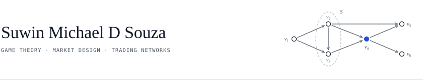

<picture>
  <source
    media="(prefers-color-scheme: dark)"
    srcset="assets/header-dark.svg"
  />
  <source
    media="(prefers-color-scheme: light)"
    srcset="assets/header-light.svg"
  />
  
</picture>

 

**Suwin Michael D Souza** · M1 Mathematics Major, Data Science Minor, IISER Thiruvananthapuram 
Research in market design, dynamic trading networks, cooperative game theory, and queueing systems. 
[suwin23@iisertvm.ac.in](mailto:suwin23@iisertvm.ac.in)

 

## Selected Research & Software

## Selected Software

**[GameTheory](https://github.com/Matherium24/GameTheory)**: An open-source Julia package for representing and solving finite strategic-form and extensive-form games using directed graph structures (`Graphs.jl`) and linear programming (`JuMP.jl` with `HiGHS`).

| Component | Solution Concept / Method | Key Routines |
| :--- | :--- | :--- |
| **Strategic-Form Games** | Dominance reduction (IESDS), pure Nash equilibria, primal-dual zero-sum minimax LP, $N \times N$ indifference systems, and ESS checks | `eliminate_strictly_dominated`, `pure_nash_equilibria`, `solve_zero_sum_lp`, `solve_indifference_full_game`, `check_mutation_ess` |
| **Correlated Equilibria** | Incentive-compatibility LP over the correlated polytope (utilitarian, player-specific, egalitarian, and weighted objectives) | `compute_correlated_equilibrium`, `is_correlated_equilibrium`, `nash_to_correlated` |
| **Behavior Strategies** | Perfect-recall verification, Kuhn's Theorem mixed/behavior equivalence, and terminal outcome probabilities on `DiGraph` game trees | `has_perfect_recall`, `mixed_to_behavior`, `behavior_to_mixed`, `are_equivalent`, `compute_outcome_probabilities` |
| **Equilibrium Refinements** | Subgame perfect equilibria (SPE) via reverse topological sort backward induction with chance-node expectations | `has_perfect_information`, `backward_induction`, `backward_induction_path` |

 

## Computational Stack

- **Optimization & Solvers:** Julia, JuMP
- **Analysis & Computing:** Python, R, C/C++, MATLAB, Wolfram Mathematica
- **Typesetting:** LaTeX

 

## Current Focus

I am extending our non-atomic cooperative framework for coalition formation in $M/M/1$ queues
to observable queue states, heterogeneous arrival classes, and pricing mechanisms, while
finalizing a manuscript on weighted budgeting games and improving move dynamics.
In parallel, I am developing an open-source Julia package using `JuMP` and graph-based
representations to solve strategic-form, extensive-form, and repeated games.